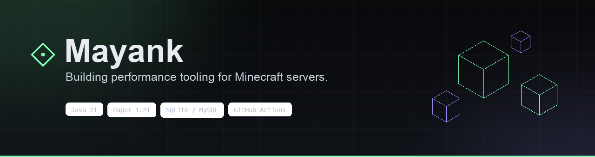

  

I build Paper plugins that keep Minecraft servers fast as player counts climb — measured under TPS pressure, covered by tests, and shipped as versioned releases.

## Featured project · [CubeCityOptimization](https://github.com/MayankPatil3/CubeCityOptimization)

A Paper 1.21+ optimization suite: one jar that puts chunks, hoppers, dispensers, TNT and mobs under explicit, tunable limits — then reports what it changed.

| Module | What it does |
| :-- | :-- |
| **Chunks** | Per-player view/simulation distance, chunk budget, idle-chunk unloading |
| **Machines** | Hopper transfer gate, per-chunk density, chain blocking; dispenser cooldowns and burst limits |
| **TNT** | Per-chunk cap, merge nearby primed TNT, explosion power and block-list trimming |
| **Mobs** | Global and per-chunk caps, reconcile pass, named/tamed/villager exemptions |
| **Ops** | TPS pressure mode, 45-slot GUI, SQLite/MySQL history, PlaceholderAPI and Vault |

[**Download v1.0.0**](https://github.com/MayankPatil3/CubeCityOptimization/releases/latest) · [Source](https://github.com/MayankPatil3/CubeCityOptimization) · [CI workflow](https://github.com/MayankPatil3/CubeCityOptimization/actions/workflows/ci.yml)

## Engineering notes

- **19 unit tests** on the logic that doesn't need a running server; GitHub Actions runs them on every push.
- **Async storage** — SQLite/MySQL snapshots and the action log never block the tick loop.
- **Shaded jar** — one file into `plugins/`, no library manager required.
- **v1.0.0** — tagged release with the built jar attached and checksum published.

## How I work

- **Tick time is the budget.** Every optimization is a trade; the counters make the trade visible.
- **Defaults should hold on a full server**, not just a test server.
- **Measure, change, verify.** Unmeasured optimization is guesswork.

## Toolbox

`Java 21` · `Paper API` · `SQLite` · `MySQL` · `PlaceholderAPI` · `Vault` · `GitHub Actions`

---

Mayank · performance tooling for Minecraft servers
